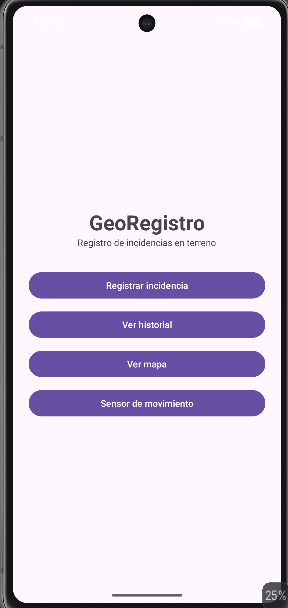
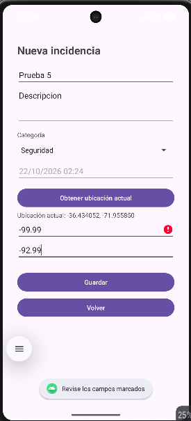
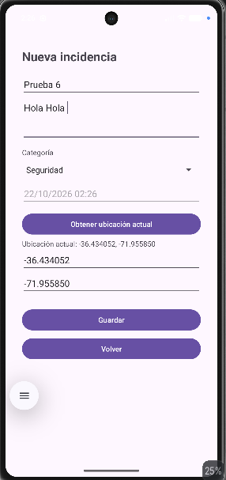
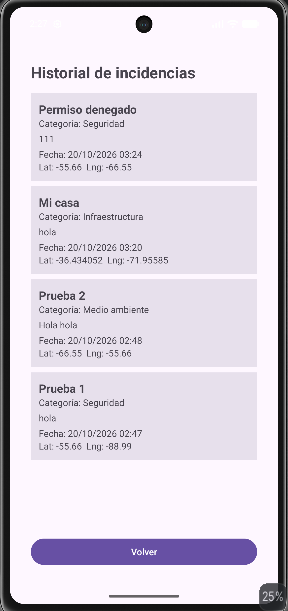
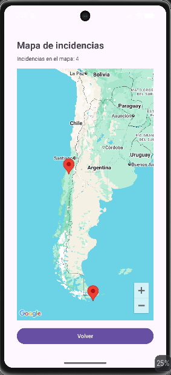
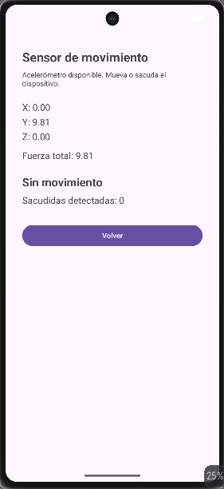
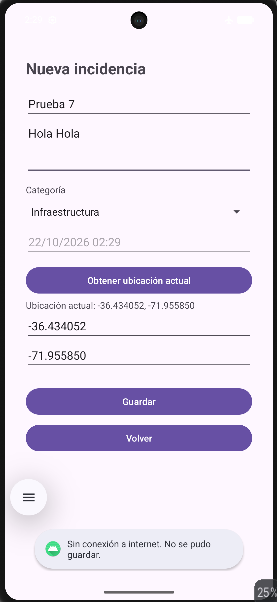

# GeoRegistro

Aplicación Android (Java) para registrar **incidencias georreferenciadas** en terreno, consultar su historial y verlas en un mapa. Trabajo individual de la asignatura **Taller de Nuevas Tecnologías (PA26-04724)**, Evaluación N.º 2, semestre 2026-2.

## Funcionalidades

| Requisito | Qué hace la app |
|---|---|
| RF01 Navegación | Pantalla principal con acceso a Registro, Historial, Mapa y Sensor mediante Activities e Intents. Todas las pantallas tienen botón **Volver**. |
| RF02 Formulario | Título, descripción, categoría, fecha y hora (automática) y coordenadas. Valida campos obligatorios y rangos (latitud -90 a 90, longitud -180 a 180). |
| RF03 Firestore | Guarda las incidencias en Cloud Firestore y recupera el historial ordenado (más reciente primero). Si no hay internet muestra un mensaje y la app no se cierra. |
| RF04 GPS | Pide el permiso de ubicación en tiempo de ejecución y llena latitud y longitud con la ubicación actual. Si se deniega el permiso o el GPS está apagado, muestra un mensaje y permite escribir las coordenadas a mano. |
| RF05 Google Maps | Muestra un marcador por cada incidencia guardada en Firestore (título, categoría y fecha al tocarlo). La clave de la API no está en el repositorio. |
| RF06 Sensor | Usa el **acelerómetro**: muestra X, Y, Z y la fuerza total en vivo, detecta sacudidas y las cuenta. Si el dispositivo no tiene el sensor, lo informa sin cerrarse. |
| RF07 GitHub | Historial de commits desde la preparación del proyecto hasta la entrega, y este README. |
| RF08 Seguridad | No se suben credenciales. Las reglas de Firestore están restringidas (ver más abajo). |

## Capturas de pantalla

| Menú principal | Formulario con validación | GPS en el formulario |
|---|---|---|
|  |  |  |

| Historial | Mapa con marcadores | Sensor |
|---|---|---|
|  |  |  |

| Sin conexión (aviso al guardar) |
|---|
|  |

## Requisitos

- **Android Studio Quail 3 | 2026.1.3 Patch 1** (versión con la que se desarrolló).
- Java 11 (incluido con Android Studio) y Gradle (el proyecto usa el wrapper `gradlew`).
- Android 8.1 (API 27) o superior, en emulador o teléfono con **Google Play services**.
- Una cuenta de Google para crear el proyecto de Firebase.

## Instalación

1. Clonar el repositorio:
   ```
   git clone https://github.com/lococlausio/GeoRegistro.git
   ```
2. Abrir la carpeta `GeoRegistro` con Android Studio y esperar a que termine el **Gradle Sync**.

El proyecto **no compila ni funciona completo** hasta hacer las dos configuraciones siguientes, porque los archivos con credenciales no se suben al repositorio.

## Configuración de Firebase

1. En [Firebase Console](https://console.firebase.google.com) crear un proyecto (plan gratuito Spark; no se necesita facturación).
2. Registrar una app Android con el nombre de paquete **`cl.reymago.georegistro`** y descargar `google-services.json`.
3. Copiar `google-services.json` dentro de la carpeta **`app/`**. Este archivo está en el `.gitignore` y no debe subirse.
4. **Authentication → Método de acceso →** activar **Anónimo**.
5. **Firestore Database → Crear base de datos** (edición Standard, modo **producción**). Las copias de seguridad programadas son opcionales y requieren plan de pago; no son necesarias.
6. **Firestore → Reglas:** pegar el contenido del archivo [`firestore.rules`](firestore.rules) y publicar.

### Reglas de seguridad de Firestore

```
match /incidencias/{id} {
  allow read: if request.auth != null;
  allow create: if request.auth != null
    && request.resource.data.titulo is string
    && request.resource.data.titulo.size() > 0
    && request.resource.data.latitud is number
    && request.resource.data.longitud is number;
  allow update, delete: if false;
}
```

Solo se puede leer y crear con una sesión (la app inicia sesión anónima automáticamente), el título no puede estar vacío, las coordenadas deben ser números y no se permite modificar ni borrar. Todo lo demás está bloqueado.

## Configuración de Google Maps (sin exponer la clave)

La clave de la API **no está en el repositorio**. Se guarda en `local.properties`, archivo que Git ignora, y Gradle la inyecta en el `AndroidManifest.xml` al compilar mediante `manifestPlaceholders` (`${MAPS_API_KEY}`).

1. En la raíz del proyecto abrir (o crear) el archivo `local.properties`.
2. Agregar una línea nueva, tomando como modelo [`local.properties.example`](local.properties.example):
   ```
   MAPS_API_KEY=su_clave_de_google_maps
   ```
3. Hacer **Sync** y ejecutar.

Para crear una clave propia: en Google Cloud Console habilitar **Maps SDK for Android** (Google exige tener la facturación habilitada en el proyecto), crear una clave de API y restringirla a aplicaciones Android con el paquete `cl.reymago.georegistro` y el SHA-1 de su equipo (`./gradlew signingReport`).

En este trabajo se utilizó la clave de Maps que el docente facilitó en clase, y por eso no se incluye aquí.

## Ejecución

1. Elegir un emulador con **Google Play / Google APIs** (API 27 o superior) o un teléfono con depuración USB, y pulsar **Run**.
2. En el emulador, para probar el GPS definir una ubicación en **Extended controls (⋯) → Location** y, para el sensor, usar **Virtual sensors**.
3. Al abrir la app por primera vez, entrar al menú principal para que se cree la sesión anónima de Firebase.

## Pruebas realizadas

Probadas en emulador de Android Studio:

| Caso | Resultado esperado | Resultado |
|---|---|---|
| Formulario con campos vacíos o coordenadas fuera de rango | Marca los errores y no guarda | Correcto |
| Guardar una incidencia válida con internet | Aparece en Firestore, en el historial y en el mapa | Correcto |
| Guardar sin internet (modo avión) | Mensaje "Sin conexión a internet" y la app sigue abierta | Correcto |
| GPS con permiso concedido | Llena latitud y longitud | Correcto |
| GPS con permiso denegado | Mensaje explicativo; se pueden escribir las coordenadas a mano | Correcto |
| GPS apagado | Mensaje "No se pudo obtener la ubicación" | Correcto |
| Historial con datos y sin internet | Lista ordenada; sin internet avisa y no se cierra | Correcto |
| Mapa con datos y sin internet | Marcadores de las incidencias; sin internet avisa y no se cierra | Correcto |
| Sensor con acelerómetro | Muestra X, Y, Z y fuerza total (≈ 9.81 en reposo) | Correcto |
| Sacudida | Muestra "¡Movimiento detectado!" y suma al contador | Por probar (implementado; falta verificar en un dispositivo real) |
| Dispositivo sin acelerómetro | Mensaje "Este dispositivo no tiene acelerómetro" | Por probar (implementado; falta verificar con un dispositivo sin ese sensor) |

## Seguridad

- `google-services.json`, `local.properties`, claves y keystores están en el `.gitignore` y se comprobó con `git grep` y `git log -S` que no hay claves en el repositorio ni en su historial.
- No se guardan datos personales reales: las incidencias de prueba son ficticias.
- Reglas de Firestore restringidas (sesión obligatoria, validación de campos, sin modificar ni borrar).

## Estructura del proyecto

```
app/src/main/java/cl/reymago/georegistro/
  MainActivity.java       Menú principal e inicio de sesión anónima
  RegistroActivity.java   Formulario, validación, GPS y guardado en Firestore
  ListadoActivity.java    Historial (RecyclerView)
  IncidenciaAdapter.java  Adaptador de la lista
  MapaActivity.java       Mapa con marcadores
  SensorActivity.java     Acelerómetro
  Incidencia.java         Modelo de datos
  Red.java                Comprobación de conexión a internet
firestore.rules           Reglas de seguridad de Firestore
local.properties.example  Modelo para configurar la clave de Maps
```

## Tecnologías

Java, Android Views (XML), Firebase Authentication (anónima), Cloud Firestore (Firebase BoM 35.0.2), Google Play services Location 21.4.0, Maps SDK for Android 20.1.0.

## Uso de inteligencia artificial

El detalle de las herramientas, consultas y partes revisadas está en [`DECLARACION_IA.md`](DECLARACION_IA.md).
